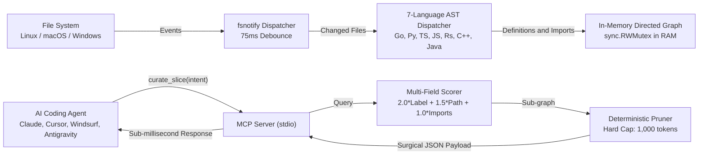

# curate-mcp

[](https://github.com/1Barak/curate-mcp/actions/workflows/ci.yml)
[](https://golang.org)
[](https://opensource.org/licenses/Apache-2.0)
[]()
[]()

> **Fast, lightweight, native Go Model Context Protocol (MCP) server for real-time AST dependency analysis and surgical codebase curation.**

`curate-mcp` maintains an in-memory directed dependency graph of your codebase, continuously synchronized via reactive file watching. When AI coding agents (Claude Code, Cursor, Windsurf, Antigravity) request context, `curate-mcp` delivers high-signal, token-capped AST subgraphs in sub-millisecond response times.

---

## ⚡ Key Highlights

- **Sub-millisecond Performance:** Queries resolve in < 1 ms directly from memory via concurrent `sync.RWMutex` adjacency maps.
- **Single Static Binary (Zero Runtime Dependencies):** No Python virtual environments, no Node.js runtime, no Docker containers, and no external graph databases (Neo4j/Memgraph). Pure static Go (`CGO_ENABLED=0`).
- **Multi-Language AST Support (7 Core Languages):** Native parsing for **Go**, **Python**, **TypeScript/TSX**, **JavaScript/JSX**, **Rust**, **C/C++**, and **Java**.
- **Real-Time Reactive Sync:** Multi-platform file watcher (`fsnotify`) with 75 ms debouncing absorbs I/O bursts and updates the in-memory graph immediately upon file changes.
- **Cross-Module Functional Graph (v1.2.0):** In-memory cross-module resolution for functional calls (`calls`) and module imports (`imports`), enabling exact pathfinding and eliminating heuristic false positives.
- **Autonomous Memory Management (v1.2.0):** Built-in soft memory cap (200 MB via `debug.SetMemoryLimit`), automatic idle memory purger (`debug.FreeOSMemory()` after 60s of inactivity), and reusable `sync.Pool` JSON buffers for zero-allocation serialization.
- **Adaptive Repo-Scale Token Budget:** Elastic context budgets (`CalculateAdaptiveBudget`: 1,000 to 3,500 tokens) with deterministic pagination (`offset_files`, `has_more`, `next_offset_files`).
- **Structural Diagnostics (v1.2.0):** Proactively detects unused imports (`unused_imports`) and dead code symbols (`dead_symbols` where `in_degree = 0`) in real time.
- **Actionable Error Self-Healing:** Standard MCP JSON-RPC `-32602` typed errors with bounded suggestions (≤ 5) and dynamic recovery `hint` directives to prevent agent hallucination loops.
- **Security-First Architecture:** Active defense against Path Traversal and workspace escape vectors.

---

## 🔍 Multi-Language Parsing Architecture & Trade-Offs

We believe in complete transparency about how `curate-mcp` achieves extreme performance and single-binary zero-dependency portability:

- **Go Language**: Full syntactic and semantic AST parsing using the standard library (`go/parser`, `go/ast`, `go/token`). Extracts packages, imports, structs, interfaces, methods, functions, and cross-package calls with complete syntax-tree fidelity.
- **Python, TypeScript/TSX, JavaScript/JSX, Rust, C/C++, Java**: High-speed, zero-CGo lexical and regex state machines designed specifically for definition extraction (functions, methods, classes, interfaces, structs) and import/call tracking without invoking native C toolchains.

### Why this Trade-Off?
1. **Single Static Binary (< 5 MB, Zero CGo)**: Native Tree-sitter C bindings require C toolchains, heavy shared libraries, or Docker containers, breaking effortless cross-compilation and cross-platform installation.
2. **Sub-second Cold Indexing**: Lexical scanners parse code at > 10,000 lines/millisecond, allowing full codebase indexing in under a second (e.g. 560+ files indexed in ~650 ms).
3. **Zero Native Memory Leaks**: Avoids C-allocated memory pools and GC friction, keeping idle RAM under 5 MB.

*Roadmap Note: For teams requiring deep syntactic type resolution in dynamic languages, an opt-in WebAssembly / pure-Go AST engine is planned for v2.0.*

---

## 🏗️ Architecture



---

## 📦 Installation & Releases

### Prebuilt Binaries (Zero Dependencies)
Download standalone precompiled executables for Linux (amd64/arm64), macOS (Intel/Apple Silicon), and Windows (amd64) directly from the [Releases](https://github.com/1Barak/curate-mcp/releases) page. No Go toolchain required.

### Build from Source
```bash
git clone https://github.com/1Barak/curate-mcp.git
cd curate-mcp

# Build native static executable (< 5 MB, CGO_ENABLED=0)
go build -o bin/curate ./cmd/curate
```

The resulting standalone binary in `bin/curate` (or `bin/curate.exe` on Windows) is < 5 MB and ready to run.

---

## 🚀 CLI Usage

```bash
# Run server using current directory as workspace
./bin/curate

# Run server with an explicit workspace
./bin/curate -workspace /path/to/project
# or with shorthand
./bin/curate -w /path/to/project

# Set custom hard token limit (default: 1000)
./bin/curate -w /path/to/project -max-tokens 800

# Print version
./bin/curate -version
```

### Dynamic Workspace Discovery
`curate-mcp` resolves the target codebase workspace in the following priority:
1. CLI flag: `-w` / `--workspace <path>`
2. Environment variable: `CURATE_WORKSPACE=<path>`
3. Current working directory: `os.Getwd()`

---

## 🔌 Agent Integrations

Pre-configured integration templates are available in the [`integrations/`](integrations/) directory.

### 1. Claude Desktop
Add to your `claude_desktop_config.json`:
```json
{
  "mcpServers": {
    "curate": {
      "command": "/absolute/path/to/bin/curate",
      "args": ["-w", "/path/to/your/workspace"]
    }
  }
}
```

### 2. Cursor
Add to `.cursor/mcp.json`:
```json
{
  "mcpServers": {
    "curate": {
      "command": "/absolute/path/to/bin/curate",
      "args": ["-w", "${workspaceFolder}"]
    }
  }
}
```

### 3. Windsurf
Add to `mcp_config.json`:
```json
{
  "mcpServers": {
    "curate": {
      "command": "/absolute/path/to/bin/curate",
      "args": ["-w", "${workspaceFolder}"]
    }
  }
}
```

### 4. Antigravity
Add to your MCP configuration:
```json
{
  "mcpServers": {
    "curate": {
      "command": "/absolute/path/to/bin/curate",
      "args": ["-w", "${workspaceFolder}"]
    }
  }
}
```

---

## 🛠️ MCP Tool Reference

### `curate_slice`
Extracts a focused AST sub-graph relevant to a specified task or user intent with adaptive token budgeting and pagination.

**Parameters:**
- `intent` *(string, required)*: Natural language description of what you are searching for or working on (e.g., `"user authentication middleware and jwt tokens"`).
- `max_files` *(integer, optional)*: Maximum number of primary files to retrieve (default: `5`).
- `offset_files` *(integer, optional)*: Zero-based file offset for deterministic pagination (default: `0`).
- `workspace` *(string, optional)*: Path to the workspace (defaults to configured root).

**Output:** Includes `primary_files`, `entrypoints`, `has_more`, `total_matching_files`, `total_matching_symbols`, `truncated_symbols_count`, `next_offset_files`, and `structural_diagnostics` (`unused_imports`, `dead_symbols`).

---

### `get_blast_radius`
Calculates upstream callers `P(u)`, downstream callees `S(u)`, Criticality Index (`I_c = 3 * in_degree + out_degree`), risk level (`BAJO`, `MEDIO`, `ALTO`, `CRÍTICO`), and persists OTel receipts to disk.

**Parameters:**
- `node_name` *(string, required)*: Target symbol or file identifier (supports automatic suffix fuzzy resolution, e.g. `"LayaInferenceEngine"` resolves to full ID).
- `depth` *(integer, optional)*: BFS traversal depth limit (default: `2`, max: `5`).
- `max_nodes` *(integer, optional)*: Maximum number of nodes to extract (default: `50`, max: `200`).
- `workspace` *(string, optional)*: Target workspace directory.

**Error Handling:** If the symbol is not found, returns MCP JSON-RPC `-32602` with bounded suggestions (≤ 5) and an actionable `hint` recovery directive to prevent agent loop conditions.

---

### `find_path`
Discovers the shortest directed dependency path between two symbols or files via functional calls and imports.

**Parameters:**
- `node_a` *(string, required)*: Origin symbol or file identifier.
- `node_b` *(string, required)*: Destination symbol or file identifier.
- `workspace` *(string, optional)*: Target workspace directory.

**Output:** Returns `connected: true/false`, `length` (hop count), and the ordered `path` array of exact functional call-sites. On lexical ambiguity (e.g. multiple `main` functions), returns `-32602` with top suggestions.

---

### `get_architecture_summary`
Provides instant topological cardinality metrics and ranks the Top God Nodes by functional degree in dual formats.

**Parameters:**
- `format` *(string, optional)*: Output representation format:
  - `"json"` *(default)*: Ultra-compact JSON (≤ 310 bytes, ~78 tokens) for zero context waste.
  - `"markdown"`: Executive Markdown report (≤ 830 bytes) with Top 5 God Nodes and topological health status.
- `workspace` *(string, optional)*: Target workspace directory.

**Example JSON Output (`format: "json"`):**
```json
{
  "status": "ok",
  "total_files": 732,
  "total_symbols": 2970,
  "total_edges": 4722,
  "edges_by_type": {
    "calls": 1511,
    "defines": 2970,
    "imports": 241
  },
  "god_nodes": [
    "pkg/auth/token.go:VerifyToken"
  ]
}
```

**Example Markdown Output (`format: "markdown"`):**
```markdown
# Architecture Summary

## Health Metrics
- **Files**: 732
- **Symbols**: 2970
- **Edges**: 4722 (calls: 1511, defines: 2970, imports: 241)

## God Nodes (Top 5)
- `pkg/auth/token.go:VerifyToken`: total_degree=36 (in=36, out=0)
- `pkg/router/routes.go:RegisterHandler`: total_degree=32 (in=32, out=0)
- `pkg/db/pool.go:QueryContext`: total_degree=24 (in=24, out=0)

## Structural Warnings
- Status: Topology health is nominal with zero critical warnings.
```

---

## 🧪 Testing & Reproducible Benchmarks

### Run Unit & Integration Tests
```bash
go test -v ./...
```
All unit tests execute in < 50 ms with zero external dependencies.

### 🏢 Real-World Codebase Benchmarks (Empirical Measurements)
Measured on physical hardware (AMD Ryzen 5, NVMe SSD) across real production and development codebases of varied scales and tech stacks:

| Codebase Archetype | Primary Stack | Code Files | Graph Nodes | Edges | Cold Index Time | Slice Latency (P50) | RAM Heap |
| :--- | :--- | :--- | :--- | :--- | :--- | :--- | :--- |
| **`curate-mcp` (Self-Scan)** | Go / MCP Server | 33 | 222 | 341 | **15.8 ms** | **999 µs (< 1 ms)** | **1.4 MB** |
| **Microservice Backend** | Node.js / Express | 44 | 216 | 321 | **62.8 ms** | **1.40 ms** | **2.1 MB** |
| **SPA Frontend Web App** | TypeScript / React | 126 | 421 | 798 | **140.7 ms** | **776 µs (< 1 ms)** | **1.6 MB** |
| **Hybrid Backend & CLI Suite** | Go + Node.js | 567 | 2,920 | 4,985 | **659.7 ms** | **3.57 ms** | **4.4 MB** |
| **Full-Stack Web Monolith** | JavaScript / Node.js | 615 | 2,064 | 3,156 | **859.0 ms** | **2.24 ms** | **4.3 MB** |
| **Enterprise Infra Monorepo** | Multi-Language | 689 | 3,393 | 4,550 | **840.4 ms** | **3.30 ms** | **3.8 MB** |

### 📈 Synthetic Monorepo Scalability Benchmarks
Validate latency and memory efficiency across 1,000 to 55,000 node graphs:

```bash
go test -bench=Benchmark -benchmem ./pkg/...
```

| Benchmark Scenario | Graph Size | Measured Latency | Throughput / Efficiency | Invariant Verified |
| :--- | :--- | :--- | :--- | :--- |
| `CurateSlice (MCP Layer)` | 1,200 nodes | **0.66 ms** (664 µs) | 1,524 ops/sec | **< 1 ms target** |
| `CurateSlice (MCP Layer)` | 11,000 nodes | **7.88 ms** | 163 ops/sec | Monorepo scale |
| `CurateSlice (Monorepo)` | 55,000 nodes | **42.1 ms** | Full AST scoring | Monorepo scale |
| `Deterministic Token Pruner` | 3,000 nodes | **0.052 ms** (52 µs) | 22,088 ops/sec | Linear O(N) |
| `Blast Radius (BFS Depth 2)` | 1,000 nodes | **0.0024 ms** (2.4 µs) | 534,201 ops/sec | Sub-millisecond |
| `Blast Radius (Monorepo)` | 55,000 nodes | **0.0024 ms** (2.4 µs) | 431,247 ops/sec | Sub-millisecond |
| `Shortest Path (Monorepo)` | 55,000 nodes | **0.0013 ms** (1.3 µs) | 894,180 ops/sec | Sub-millisecond |

---

## 🗺️ Roadmap & Community Feedback

`curate-mcp` is under active development. We are prioritizing upcoming features based directly on community demand:

- [ ] **Massive Monorepos (>100k files):** Hybrid in-memory + embedded persistent indexing (SQLite/DuckDB) for instant warm boots on giant codebases.
- [ ] **Cross-Repository & Microservices:** Graph stitching across distributed services (Protobuf, gRPC, OpenAPI contracts).
- [ ] **CI/CD GitHub Action:** Automated Pull Request blast radius & AST impact analysis for ultra-low-token AI code reviews.
- [ ] **Additional Languages:** C#, Kotlin, Swift, PHP, and SQL schema mappings.
- [ ] **Interactive Visual Graph Inspector:** Local lightweight web UI to visually navigate dependency subgraphs.

### 💬 Share Your Use Case!
- Are you working with an enterprise monorepo or a large distributed team?
- Need a specific language grammar or custom agent integration?

👉 **[Open an Issue](https://github.com/1Barak/curate-mcp/issues)** or start a **Discussion** sharing your use case. Community feedback directly shapes our development priorities!

---

## 📄 License & Attribution

- Licensed under the **[Apache License, Version 2.0](LICENSE)**.
- See **[NOTICE](NOTICE)**: Architectural concepts regarding in-memory AST and graph-based codebase curation are inspired in part by [Graphify](https://github.com/Graphify-Labs/graphify) (Apache-2.0, Copyright Graphify-Labs Authors).
